<!-- Header banner -->

  

<!-- Terminal card: ASCII portrait + info -->

  

<!-- TECH STACK: filled in after we review the projects -->

<!-- FEATURED PROJECTS: filled in after the projects are cleaned up and pushed -->

<!-- Connect (CV badge goes here once the PDF is ready) -->

  
  
  
   
  
  

<!-- Footer wave -->

